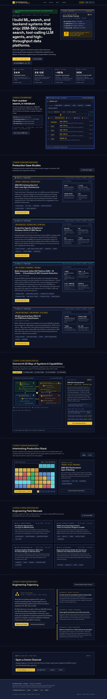

# Harsha Tummala — Senior ML & Systems Engineer Portfolio

[](https://github.com/harsha6107/harsha6107.github.io/actions/workflows/deploy.yml)

> **I build ML, search, and backend systems that ship: 26M-SKU catalog search, tool-calling LLM agents, and high-throughput data platforms.**

Live production site: **[https://harsha6107.github.io](https://harsha6107.github.io)**

---

## Preview

| Dark Mode (`1440px` — Midnight Arcade Cabinet) | Light Mode (`1440px` — Famicom Strategy Manual) |
| :--- | :--- |
|  |  |

---

## Architecture & Design System

| Layer | Technology | Version / Specification |
| :--- | :--- | :--- |
| **Framework** | [Astro](https://astro.build/) | `7.4.12` (`output: 'static'`, zero-JS default, selective lazy islands) |
| **Language** | [TypeScript](https://www.typescriptlang.org/) | `7.0.2` (`astro/tsconfigs/strict`, `exactOptionalPropertyTypes: true`) |
| **Content Engine** | Astro Content Collections (`glob` loader) + [MDX](https://mdxjs.com/) | `@astrojs/mdx@8.1.6` with strict Zod schemas in `src/content.config.ts`. |
| **Styling & Tokens** | Tactile 16-Bit Native CSS | Cascade layers (`@layer reset, tokens, base, layout, components, utilities, motion`), beveled cartridge surfaces, microswitch push-buttons, `@container` queries, strict 8pt (`0.5rem`) grid. |
| **Typography** | Self-hosted WOFF2 Fonts | `@fontsource-variable/space-grotesk` (editorial/prose), `@fontsource/silkscreen` (16-bit HUD, scores & stage badges), and `@fontsource-variable/jetbrains-mono` (code, SKUs & math). |
| **Pixel Iconography** | Bespoke Crisp-Edge SVGs | `src/components/RetroSprite.astro` (`shape-rendering="crispEdges"`, zero raster blur). |
| **OpenGraph Images** | Build-Time SVG → PNG | `satori` + `@resvg/resvg-js` generating `1200×630` Game Pak cards at `/og/[...slug].png`. |
| **Linting & Formatting** | [Biome](https://biomejs.dev/) | `@biomejs/biome@2.6.7` |
| **E2E & Accessibility** | [Playwright](https://playwright.dev/) + [Axe](https://github.com/dequelabs/axe-core) | `@playwright/test` + `@axe-core/playwright` enforcing zero WCAG 2.2 AA violations across all routes in Light & Dark themes and zero horizontal overflow (`320px` → `2560px`). |
| **Performance Gate** | [Lighthouse CI](https://github.com/GoogleChrome/lighthouse-ci) | `@lhci/cli` enforcing **100 / 100** across Performance, Accessibility, Best Practices, and SEO on mobile (`LCP < 1.5s`, `CLS < 0.02`, `TBT < 100ms`). |

---

## Smart Retro Game Integrations & Signature Engineering Moments

1. **Pac-Man — 26M-SKU Maze Console (`src/components/SearchDemo.astro` + `src/utils/sku-search.ts`)**
   - Rebuilds the 4-tier part-number matcher (`Exact` → `Blinky Normalized` → `Inky Prefix` → `Pinky Fuzzy` → `Clyde Keyword`) inside a double-walled arcade maze cabinet with power-pellet sample chips and SSR zero-CLS first paint.
2. **Super Mario World — Overworld 2D Latent Map & `[?]` Mystery Block (`src/components/EmbeddingMap.astro` + `src/pages/index.astro`)**
   - Projects 18 projects, field manuals, and capabilities across 4 Overworld biomes with live `k=3` cosine-similarity dotted travel paths.
   - Includes a playable riveted `[?]` Mystery Block on the Player 1 Hero Card that pops coins and dispenses 6 hidden production engineering notes.
3. **Tetris — Interlocking Capability Well (`src/components/TetrisStack.astro`)**
   - Packs 7 production engineering domains (`I`, `T`, `L`, `J`, `S`, `Z`, `O` Tetrominoes) into a 10×6 matrix well with interactive domain inspection and a playable **Hard Drop `I`-Piece** line-clear action.
4. **The Legend of Zelda — Triforce Principles, Boss Key Reading Lens & 5-Relic Quest Log**
   - Frames the 3 core architectural principles as the **Triforce of Wisdom, Courage & Power**, styles the Summary/Engineer deep-dive fold as a **Boss Key Door**, turns `/404.html` into the iconic `"IT'S A SECRET TO EVERYBODY."` cave room, and tracks **5 collectible retro relics** + optional WebAudio 8-bit chiptune SFX (`M`) and the Konami Code (`↑↑↓↓←→←→BA`).

---

## Repository Structure

```text
├── .github/
│   ├── dependabot.yml              # Weekly automated npm & GitHub Actions updates
│   └── workflows/deploy.yml        # Quality gates + GitHub Pages deployment
├── public/
│   ├── favicon.svg                 # 16x16 pixel cartridge emblem
│   ├── images/                     # Portfolio preview screenshots
│   ├── resume/Harsha_Tummala.pdf   # Printable engineering résumé PDF
│   ├── robots.txt                  # Crawler directives + sitemap pointer
│   └── scripts/embedding-map.js    # Lazy-loaded Overworld 2D UMAP k-NN island
├── src/
│   ├── assets/profile.jpg          # Source portrait optimized to WebP via astro:assets
│   ├── components/
│   │   ├── ArchitectureDiagram.astro # 5 bespoke accessible SVG system schematics
│   │   ├── CommandPalette.astro    # ⌘K Warp Whistle <dialog> command palette
│   │   ├── EmbeddingMap.astro      # Overworld 2D UMAP Explorer + static ledger fallback
│   │   ├── ProjectCard.astro       # Tactile 16-bit Game Pak stage card with View Transitions
│   │   ├── RetroSprite.astro       # Crisp-edge 16x16 pixel-art SVG sprite library
│   │   ├── SearchDemo.astro        # Pac-Man 26M SKU Maze Console (SSR + lazy hydration)
│   │   └── TetrisStack.astro       # Interactive 10x6 Tetromino capability matrix & line clear
│   ├── content/
│   │   ├── site/main.json          # All bio, hero high scores, SKU demo index & UI copy
│   │   ├── projects/*.mdx          # 5 production engineering case studies
│   │   └── writing/*.mdx           # 4 technical architecture field manuals
│   ├── content.config.ts           # Strict Zod schemas for projects, writing & site collections
│   ├── layouts/BaseLayout.astro    # Arcade HUD, 5-Relic Quest Log, 8-bit WebAudio synth & shortcuts
│   ├── pages/
│   │   ├── index.astro             # Home: P1 card, [?] block, Pac-Search, Overworld & Tetris stack
│   │   ├── about.astro             # Player 1 character sheet, campaign timeline & skill slots
│   │   ├── resume.astro            # Official cartridge specification + clean print stylesheet
│   │   ├── 404.astro               # Zelda "Secret Cave" fault room with Warp Whistle routes
│   │   ├── rss.xml.ts              # RSS 2.0 feed for technical writing
│   │   ├── og/[...slug].png.ts     # Build-time Satori + Resvg Game Pak OpenGraph PNG generator
│   │   ├── projects/               # World Select + [slug].astro Boss Key case study layout
│   │   └── writing/                # Field Manuals archive + [slug].astro scroll layout
│   ├── scripts/search-demo.ts      # Browser controller for the Pac-Search SKU maze
│   ├── styles/global.css           # Cascade layers, Midnight Arcade & Famicom Manual tokens
│   └── utils/sku-search.ts         # Pure Exact/Normalized/Prefix/Fuzzy/Keyword matcher
└── tests/
    ├── check-bundle-size.mjs       # Enforces <50 KB home JS & <30 KB signature island
    ├── portfolio.spec.ts           # 32 Playwright + Axe WCAG 2.2 AA, viewport & retro UX tests
    └── serve-dist.mjs              # Zero-dependency static server for CI testing
```

---

## How to Add a Project Case Study

1. Create a new `.mdx` file in `src/content/projects/` (e.g., `src/content/projects/06-my-new-system.mdx`).
2. Populate the frontmatter matching the `projects` Zod schema in `src/content.config.ts`:

```mdx
---
title: "Distributed Vector Index & Real-Time Reranker"
shortTitle: "Vector Index & Reranker"
slug: "vector-index-reranker"
order: 6
featured: true
company: "eParts Services"
timeframe: "2026"
role: "Senior ML Engineer"
domain: "Search & Retrieval"
headlineMetric: "14 ms p99 · +19% NDCG@10"
summary: "One-paragraph executive summary of the production system and measurable outcome."
problem: "Why the legacy architecture failed under production load."
approachSummary: "How the new architecture solved the bottleneck."
constraints:
  - "Strict <20 ms p99 latency SLA across 26M vectors."
  - "Zero downtime during daily index compaction."
stack:
  - "Rust"
  - "Qdrant"
  - "ONNX Runtime"
  - "Python"
metrics:
  - value: "14 ms"
    label: "p99 Rerank Latency"
    detail: "INT8 quantized cross-encoder on CPU"
  - value: "+19%"
    label: "NDCG@10 Lift"
    detail: "Evaluated on 10K human-labeled queries"
diagramId: "search-26m"
retrospective:
  - title: "Quantize earlier in the pipeline"
    lesson: "Moving from FP16 to INT8 cut memory bandwidth 2x with <0.3% recall drop."
links:
  - label: "GitHub Repository"
    url: "https://github.com/harsha6107"
embedding:
  x: 24
  y: 26
  cluster: "search"
  vector: [0.95, 0.25, 0.30, 0.40]
---

## Context & Failure Modes

Write the deep-dive technical narrative, equations, benchmarks, and code blocks here...
```

3. Run `pnpm run build` — Astro automatically validates the schema, generates `/projects/vector-index-reranker/`, builds the OpenGraph card at `/og/projects/vector-index-reranker.png`, and plots the new node on the 2D UMAP Embedding Map and `⌘K` Command Palette.

---

## How to Add a Technical Essay

1. Create a new `.mdx` file in `src/content/writing/` (e.g., `src/content/writing/my-new-post.mdx`).
2. Add frontmatter matching the `writing` Zod schema in `src/content.config.ts`:

```mdx
---
title: "Designing Zero-Copy Feature Stores with Arrow Flight"
slug: "zero-copy-feature-stores-arrow-flight"
pubDate: 2026-04-01
readingTime: "7 min read"
category: "Data Systems"
summary: "How Arrow Flight eliminates serialization overhead for high-throughput online ML inference."
tags:
  - "Apache Arrow"
  - "Feature Store"
  - "Python"
relatedProject: "cdc-snowflake-pipeline"
embedding:
  x: 22
  y: 78
  cluster: "data"
  vector: [0.20, 0.15, 0.94, 0.30]
---

Write your MDX essay with Shiki-highlighted code blocks and LaTeX math...
```

---

## Local Development & Quality Gate Commands

```bash
# Install dependencies
pnpm install

# Start local development server (http://localhost:4321)
pnpm run dev

# 1. Lint & format check via Biome
pnpm run check

# 2. Typecheck + Static build + OpenGraph PNG generation
pnpm run build

# 3. Verify JS budget (< 50 KB home JS, < 30 KB lazy UMAP island)
node tests/check-bundle-size.mjs

# 4. Run Playwright E2E + Axe WCAG 2.2 AA accessibility & responsive tests (320px–2560px)
pnpm run test:e2e

# 5. Run Lighthouse CI mobile assertions (100/100 across all 4 categories)
pnpm run lhci
```

---

## Deployment (GitHub Pages)

This repository is configured as a root user site (`harsha6107.github.io`) with `site: 'https://harsha6107.github.io'` in [`astro.config.mjs`](astro.config.mjs).

Every push to `main` triggers [`.github/workflows/deploy.yml`](.github/workflows/deploy.yml):
1. **Quality Gate Job (`quality-gates`)**: Runs Biome, Astro typecheck & build, JS bundle budget checks, Playwright + Axe WCAG 2.2 AA tests, and Lighthouse CI mobile 100/100 assertions, then uploads `./dist` as a Pages artifact.
2. **Deploy Job (`deploy`)**: Publishes the verified `./dist` artifact to GitHub Pages via `actions/deploy-pages@v4`.

To enable GitHub Actions deployment in repository settings:
- Navigate to **Settings → Pages → Build and deployment → Source** and select **GitHub Actions** (or run `gh api -X PUT repos/harsha6107/harsha6107.github.io/pages -f build_type=workflow`).
